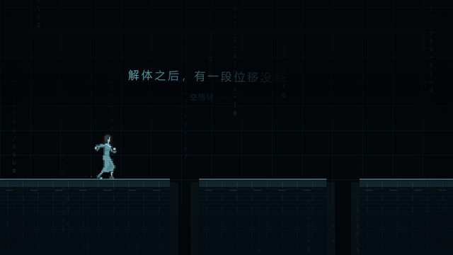
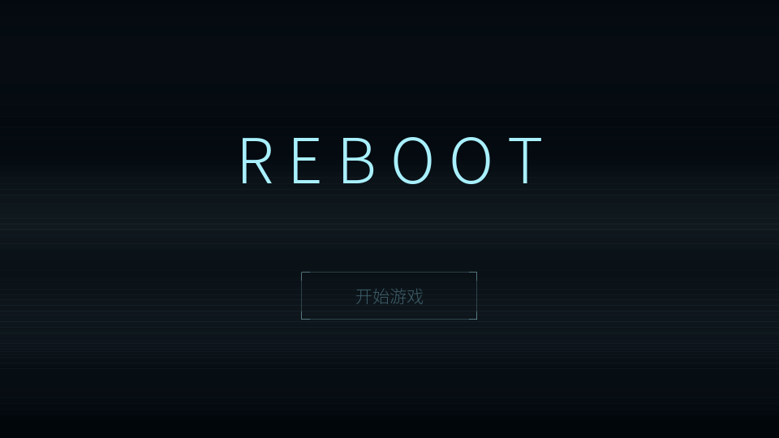
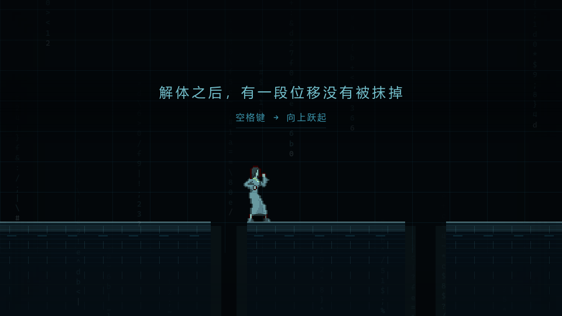
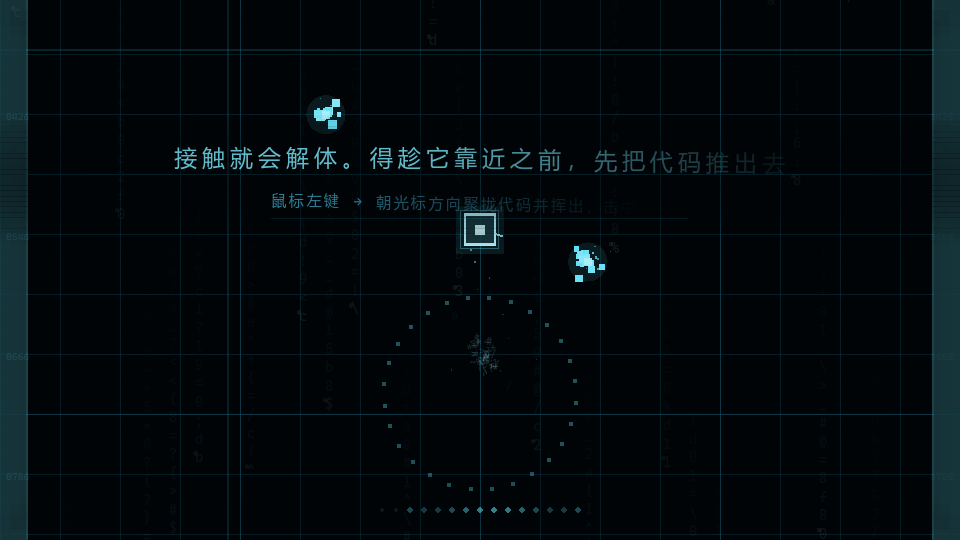
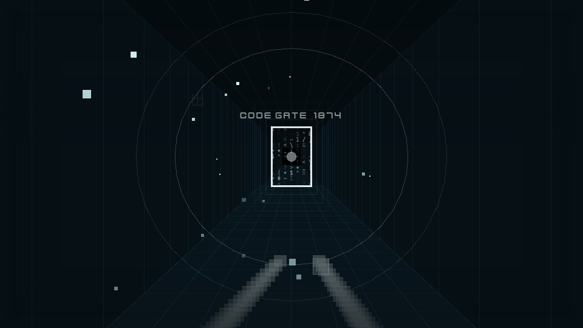
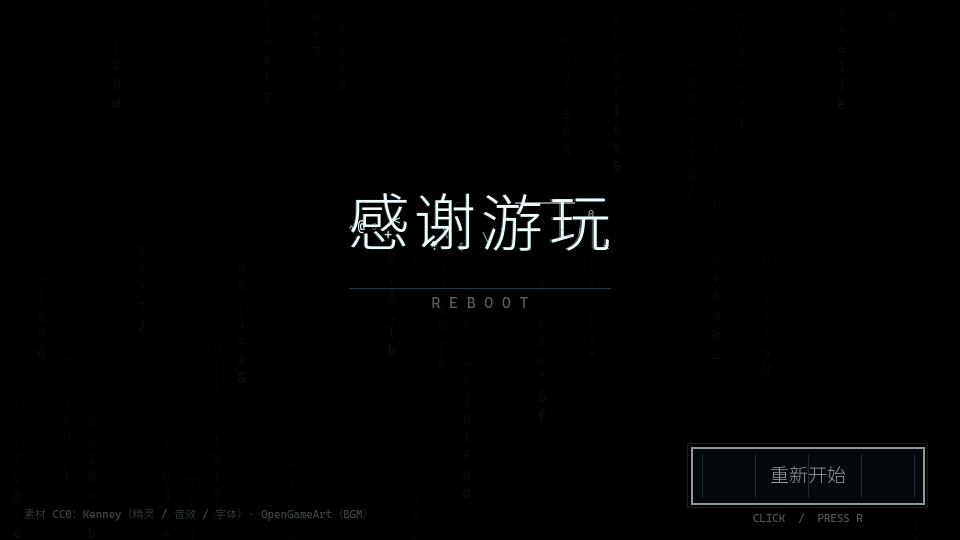

# REBOOT


**▶ [点这里直接在浏览器里玩](https://reboot-game.app.workbuddy.host)**（约 53 MB，首次加载需要等进度条走完；需要键盘和鼠标）

一个关于**解体与重组**的 2D 短流程游戏。主角是一个人工智能实体，
它在一次解体之后醒来，只剩下左右两个方向可用；每摔死一次，就从自己的残骸里
捞回一点新的动作。

**平台跳跃 → 上帝视角战斗 → 2D 第一人称走廊 → 结局**，完整流程约三分钟。



## 画面

| 标题页 | 平台跳跃 |
|---|---|
|  |  |
| 蓝青色代码空间，背景是缓慢落下的代码雨 | 第一次解体之后，浮出「结论 + 键位」双行提示 |

| 上帝视角战斗 | 2D 第一人称走廊 |
|---|---|
|  |  |
| 朝光标方向聚拢自身代码挥出，击中即击碎 | 手写透视投影的通道，尽头是 CODE GATE |



## 操作

| 按键 | 作用 | 何时可用 |
|---|---|---|
| <kbd>A</kbd> / <kbd>D</kbd> | 向左 / 向右移动 | 全程 |
| <kbd>空格</kbd> | 向上跃起 | 第一次坠落之后 |
| <kbd>Shift</kbd> 长按 | 奔跑，水平速度持续上升 | 远距离平台坠落之后 |
| 鼠标左键 | 朝光标方向聚拢代码并挥出，击中即击碎 | 战斗第一次死亡之后 |
| <kbd>W</kbd> / <kbd>A</kbd> / <kbd>D</kbd> | 第一人称走廊：前进 / 原地转身 | 走廊段 |
| <kbd>R</kbd> | 重新开始 | 全程 |

## 引导设计

提示刻意做得很轻。不写主语（既不用「我」，也不写「它」），不用系统通知的口吻
（没有时间戳、没有 `[SYS]` 前缀、没有「已解锁」）。它只在角色**死过一次**之后浮出来，
读起来是它自己从残骸里推出来的一句话；紧跟一行等宽字体的键位，明确写出哪个键触发什么。

```
解体之后，有一段位移没有被抹掉
    空格键 → 向上跃起
```

能力在被解锁之前按下去不会有反应，画面边缘只给一次轻微的呼吸，不给文字报错。

## 玩法推进

| 阶段 | 内容 | 教学点 |
|---|---|---|
| `boot` | 标题页，点「开始游戏」后黑场过渡 | — |
| `teach` | 平台跳跃，三段间距递增的缺口 | 移动 → 跳跃 → 奔跑助跑 |
| `battle` | 上帝视角战斗，三波共 15 只 | 沿光标方向出拳、绕开接触 |
| `corridor` | 2D 第一人称走廊，走向尽头的门 | 前进与转身 |
| `ending` | 结局，字幕逐字由乱码编译成型 | — |

## 技术要点

- **阶段状态机**：五个阶段各自是自包含的脚本类，完成时只发一个 `finished` 信号，
  `main.gd` 负责顺序切换。阶段之间没有共享状态，加一段不用改别处。
- **固定步长物理**：游戏逻辑跑 `1/60` 固定步长，视觉与相机用真实 delta，
  所以不同帧率下跳跃距离完全一致。
- **关卡数值倒推**：由 `滞空 0.648s × 水平速度` 反推跳跃射程
  （走跳 100px / 跑跳 207px），再把三个缺口设成 62 / 70 / 165px —
  对应「走跳可达，留容错」「走跳可达，更紧一点」「走跳必然够不到，必须助跑」。
- **走廊是纯 2D 的**：没有 3D 节点，走廊用自己写的透视投影 + 近平面裁剪画出来，
  相机只有 `x / z / yaw` 三个自由度。
- **配色集中管理**：`pal.gd` 一张表定义四个阶段的色温，阶段切换时整体平滑过渡。
  全部色相收在「青蓝 → 深蓝」区间内，不含暖色。
- **Web 端字体自包含**：中文与等宽字体按游戏实际用到的字符集生成子集
  （Noto Sans SC Light 301 KB + Cascadia Mono 20 KB）随包携带，
  桌面 / Web 两端渲染一致，不依赖系统装了什么字体。
- **素材层不崩**：`assets.gd` 访问任何素材失败都返回 `null`，绘制端遇到 `null`
  自动降级成程序化绘制，不会因为缺一张图而白屏。

## 目录

```
main.tscn              唯一入口
export_presets.cfg     Web 导出预设（nothreads 模板，静态托管可直接部署）
scripts/
  main.gd              阶段状态机
  pal.gd               全局色温：蓝青色代码空间，四阶段平滑过渡
  assets.gd            素材访问层，任何素材缺失都返回 null，由绘制端降级
  sfx.gd               音效池 + BGM 交叉淡入
  tx.gd                文字居中 / 右对齐（draw_string 的 width 传负数会忽略对齐参数）
  fx/                  代码雨、代码粒子、绘制代理
  hud/whisper.gd       提示系统：双行「结论 + 键位」，逐字缓慢淡入
  phase/               boot / teach / battle / corridor / ending
assets/                精灵、瓦片、粒子、UI、音效、BGM、字体
docs/                  README 用的动图与截图
```

## 运行

**浏览器**：直接打开 <https://reboot-game.app.workbuddy.host>。

**本地**：需要 Godot 4.7。用 Godot 打开本目录按 <kbd>F5</kbd>，或：

```bash
godot --path .
```

窗口 960×540，GL Compatibility 渲染，无插件依赖，克隆下来直接能跑。

**导出 Web 版**：仓库里带好了 `export_presets.cfg`（Web / nothreads），
导出后得到 `index.html / .js / .wasm / .pck` 四个文件，任何静态服务器都能部署，
不需要配置 COOP/COEP 响应头：

```bash
godot --headless --path . --export-release "Web" ./build/index.html
```

## 素材与授权

- **角色** — [MV Platformer Female (32x64)](https://opengameart.org/)（OpenGameArt，CC0）。
  32×64 图集，身体 / 服装 / 发型分层，可在引擎里自由叠色。
- **瓦片、UI、音效** — [Kenney](https://kenney.nl/)（CC0）：platformer-art-deluxe、
  particle-pack、ui-pack、interface-sounds、impact-sounds、digital-audio、sci-fi-sounds
- **背景音乐** — OpenGameArt（CC0）
- **字体** — Kenney Future（CC0）；随包中文字体子集取自
  [Noto Sans SC](https://fonts.google.com/noto/specimen/Noto+Sans+SC)（SIL OFL 1.1），
  等宽子集取自 Cascadia Mono（MIT）

`assets/` 下保留了少量当前没有调用点的素材：`sprites/player/`、`sprites/bg/`、`ui/`
以及大部分粒子贴图。访问函数还在，但没有任何地方调用它们，想精简可以直接删。
